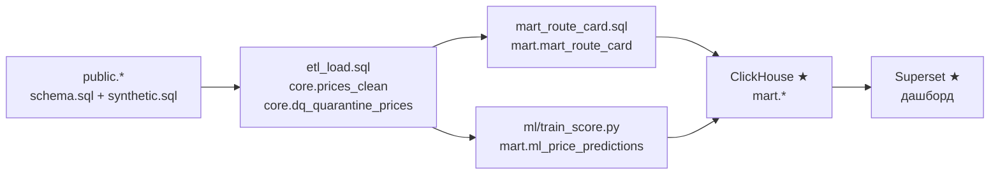

# Тестовое задание — аналитика и прогноз тарифов грузоперевозок

Решение тестового задания Middle Data Engineer

Конвейер из трёх частей поверх синтетической БД `deals_bigdata`:

1. **ETL и Data Quality** — очистка сделок, пересчёт в рубли, карантин брака, загрузка в `core`.
2. **Витрина `mart_route_card`** — коридор ставок P25 / P50 / P75 за рейс и за км, доказательная база, MoM / YoY, надёжность.
3. **ML** — CatBoost прогнозирует ставку за рейс, прогнозы для test и будущих заявок пишутся в `mart.ml_price_predictions`.

Бонусы: **Airflow** (DAG по расписанию), **ClickHouse** (копия витрин на `MergeTree`), **Superset** (дашборд).

---

## Архитектура



| Слой | Где | Что лежит |
| :--- | :--- | :--- |
| `public` | Postgres | источник: `sql/schema.sql` + `sql/synthetic.sql`, не меняется |
| `core` | Postgres | `prices_clean` — очищенные сделки с `price_rub`; `dq_quarantine_prices` — брак с кодом причины; представления `v_city`, `v_price_body_group` |
| `mart` | Postgres | `mart_route_card` — витрина; `ml_price_predictions` — прогнозы |
| `mart` ★ | ClickHouse | копия обеих витрин на `MergeTree` |

### Почему такой стек
- **PostgreSQL 17** — основное хранилище по ТЗ.
- **Очистка и витрина на SQL (ELT).** Данные не покидают базу, вставка пакетная, без построчных `INSERT` в Python. Python только запускает SQL и пишет итоги в лог.
- **Идемпотентность — `DELETE` + `INSERT` в одной транзакции.** Повтор за тот же период не создаёт дублей; при ошибке всё откатывается.
- **CatBoost** — рекомендован в R&D-отчёте, сам работает с категориями и не требует масштабирования.
- **Apache Airflow (LocalExecutor)** — оркестратор: регулярный DAG по расписанию, окно дат через параметры запуска, повторы задач и логи в одном интерфейсе. LocalExecutor вместо Celery — один DAG не требует Redis и отдельных воркеров.
- **ClickHouse** — колоночная копия витрин для быстрых BI-запросов; **Superset** — дашборд поверх неё.
- Airflow, ClickHouse и Superset используют те же SQL-файлы и код, поэтому результаты совпадают с обязательной частью.

---

## Запуск

```bash
docker-compose up -d
```

`.env` не обязателен: у всех переменных есть значения по умолчанию (см. `.env.example`).

Что происходит:
1. Postgres создаёт базы `deals_bigdata`, `airflow`, `superset`, загружает `sql/schema.sql` и генерирует 300 000 сделок из `sql/synthetic.sql`.
2. Airflow сам запускает DAG `create_schema` (схемы `core` и `mart`) и `etl_prices` (ETL → витрина → ML).
3. Superset импортирует дашборд из `superset/dashboard.zip` и подключения к ClickHouse и Postgres.
4. **Вручную** в Airflow: DAG `export_to_clickhouse` — копия витрин в ClickHouse, после него дашборд показывает данные.

| Сервис | Адрес | Логин |
| :--- | :--- | :--- |
| Airflow | http://localhost:8080 | `admin` / `admin` |
| Superset | http://localhost:8088 | `admin` / `admin` |
| Postgres | `localhost:5433`, база `deals_bigdata` | `postgres` / `postgres` |
| ClickHouse | http://localhost:8123, база `mart` | `default` / `clickhouse` |

---

## Повторный запуск за период (backfill)

**Airflow:** DAG `etl_prices` → **Trigger DAG w/ config**:
```json
{"start_date": "2026-08-01", "end_date": "2026-08-31"}
```
Пустые даты — вся история (так идёт запуск по расписанию). Перезаписываются только сделки с `loading_date` в окне, витрина и прогнозы пересчитываются целиком.

**Без Airflow** (локально, нужен Python 3.11 и переменные `PG*` из `.env`):
```bash
uv venv --python 3.11
uv pip install -r requirements.txt
uv run --env-file .env python -m etl.pipeline --start 2026-08-01 --end 2026-08-31
uv run --env-file .env python -m ml.train_score
```
`etl.pipeline` выполняет ETL и витрину, `ml.train_score` — обучение и скоринг. Дата снимка — переменная `AS_OF` (по умолчанию `2026-10-26`).

---

## Вопрос 1. ETL и Data Quality

Файлы: [`sql/etl_load.sql`](sql/etl_load.sql), [`etl/pipeline.py`](etl/pipeline.py).

Строки источника за окно дат проверяются по правилам ниже. У строки одна причина — первая сработавшая. Брак уходит в `core.dq_quarantine_prices`, остальное — в `core.prices_clean`.

| Код причины | Правило | Строк |
| :--- | :--- | ---: |
| `PRICE_NON_POSITIVE` | `price <= 0` | 164 |
| `RUB_PRICE_LOWER_1000` | `currency_code = '643' AND price <= 1000` | 0 |
| `DISTANCE_NON_POSITIVE` | `distance <= 0` | 0 |
| `WEIGHT_NEGATIVE` | `total_weight < 0` | 0 |
| `VOLUME_NEGATIVE` | `total_volume < 0` | 0 |
| `UNKNOWN_CITY` | города погрузки или выгрузки нет в `cities` | 0 |
| `NO_RATE_MATCH` | USD/EUR без курса на `nearest_rate_date` | 39 |
| **В `core`** | | **299 797** |

- **Валюты.** `price_rub = price × курс`, курс — из `exchange_rates` строго на `nearest_rate_date`, без подбора по `loading_date`. Для RUB курс = 1, поэтому 1 428 рублёвых сделок с пустой `nearest_rate_date` не отбраковываются.
- **Категории.** Пустые `weight_category` / `volume_category` заполняются по правилу ТЗ (вес округляется до 0,1 т). В синтетике пропусков нет.
- **Совпадение городов** погрузки и выгрузки не отбраковывается (ТЗ: не DQ-правило). В данных таких пар нет.
- **Итог в лог:** `LOADED`, число строк по каждой причине.

### Ограничения данных
- **`outlier_mark` за `2026-10-26`.** Сделки, созданные в день снимка, не прошли ночную разметку выбросов: размечено 3 из 4 982. Флаг не пересчитывается (требование ТЗ). Из них 118 сделок с погрузкой до 26.10 попадают в октябрьскую витрину и в test ML — ожидаемо 2–3 неотмеченных выброса; остальные 4 864 — будущие заявки.
---

## Вопрос 2. Витрина `mart.mart_route_card`

Файлы: [`sql/core_schema.sql`](sql/core_schema.sql) (представления), [`sql/mart_schema.sql`](sql/mart_schema.sql), [`sql/mart_route_card.sql`](sql/mart_route_card.sql).

**Ячейка:** месяц (`price_dates.price_date`) × город погрузки × город выгрузки × группа кузова × весовая категория. Первичный ключ — вся ячейка.

**Аномалии справочников:**
- `core.v_city` — одна строка на `gc_id` (минимальный `id`). Дубли только у Москвы (1001) и Казани (1003). Витрина группирует по `gc_id` и с `cities` не соединяется, поэтому задваиваться нечему.
- `core.v_price_body_group` — пары «сделка × группа кузова» без дублей: коды из `price_body_types`, без них — `prices.body_type`, без него — `Не указан`. Сделка с двумя кодами одной группы (56 + 61) считается в группе один раз; сделка с двумя группами (Тент + Борт) входит в обе.

**Метрики:** `p25/median/p75/avg_trip`, `p25/median/p75_km` (`percentile_cont`), `trips_count`, `carriers_count` (`price_type IN (3, 9)`), `cv_rate` (`NULL` при n < 2), `mom_pct` / `yoy_pct` — строго к календарному соседу, иначе `NULL`; `reliability_level`: `HIGH` — ≥ 30 рейсов, ≥ 5 перевозчиков и последняя сделка не старше 30 дней до `as_of`; `MEDIUM` — ≥ 10 рейсов; иначе `LOW_DATA`.

**Итог:** 203 644 ячейки за 2023-10 … 2026-10: `HIGH` 10, `MEDIUM` 924, `LOW_DATA` 202 710. Витрина пересчитывается целиком.

### Примеры запросов

Коридор одного маршрута по месяцам:
```sql
SELECT month, p25_trip, median_trip, p75_trip, median_km,
       trips_count, carriers_count, mom_pct, yoy_pct, reliability_level
FROM mart.mart_route_card
WHERE loading_city_gcid = 1001 AND unloading_city_gcid = 1003
  AND body_group = 'Тент' AND weight_category = 'FTL'
ORDER BY month;
```

Надёжные направления последнего месяца:
```sql
SELECT c1.city || ' → ' || c2.city AS route, r.body_group, r.weight_category,
       r.median_trip, r.median_km, r.trips_count, r.reliability_level
FROM mart.mart_route_card r
JOIN core.v_city c1 ON c1.gc_id = r.loading_city_gcid
JOIN core.v_city c2 ON c2.gc_id = r.unloading_city_gcid
WHERE r.month = '2026-10-01' AND r.reliability_level <> 'LOW_DATA'
ORDER BY r.trips_count DESC;
```

Факт vs прогноз — сделки, закрытые заметно выше прогноза:
```sql
SELECT price_id, loading_date, actual_price_rub, predicted_price_rub, ape_pct
FROM mart.ml_price_predictions
WHERE actual_price_rub > predicted_price_rub * 1.3
ORDER BY ape_pct DESC
LIMIT 20;
```

ClickHouse — медиана по группам кузова за октябрь:
```sql
SELECT body_group, round(avg(median_km), 2) AS median_km, sum(trips_count) AS trips
FROM mart.mart_route_card
WHERE month = '2026-10-01'
GROUP BY body_group
ORDER BY median_km DESC;
```

---

## Вопрос 3. ML и batch-скоринг

Файлы: [`ml/train_score.py`](ml/train_score.py), [`sql/ml_dataset.sql`](sql/ml_dataset.sql).

- **Выборка:** `core.prices_clean`, `is_fact AND NOT complex`; таргет `price_rub`.
- **Разбиение по `loading_date`** от `as_of = 2026-10-26`, без перемешивания:
  - train `[2026-07-26, 2026-10-05)` без выбросов — 24 226 сделок;
  - test `[2026-10-05, 2026-10-26]` — 13 078 (метрики — на 12 808 без выбросов);
  - future `> 2026-10-26` — 4 891.
- **Признаки:** регион и город погрузки и выгрузки раздельно, координаты, `distance`, `total_weight`, `total_volume`, группа кузова (по основному кузову), весовая и объёмная категории, `year` и sin/cos месяца, дня недели и дня года.
- **Защита от утечек:** цена в любом виде, `price_group_stats.*`, `price_group_id` и `outlier_mark` не загружаются в признаки; списки `FEATURES` / `FORBIDDEN` в коде, тест проверяет пересечение. Статистик «по train» нет: CatBoost не требует масштабирования и заполнения пропусков, выбросы убираются готовым флагом.
- **Модель:** `CatBoostRegressor(iterations=1000, learning_rate=0.05, depth=6, loss_function="RMSE", random_seed=42)`. Выборка сортируется по `price_id` — без этого после перезагрузки периода порядок строк меняется и прогнозы тоже.

### Метрики на test (Docker)

| R² | MAPE | RMSE | MAE |
| :-: | :-: | :-: | :-: |
| 0,9183 | 15,73% | 54 687 ₽ | 28 223 ₽ |

Ориентир R&D-отчёта — R² ~0,93, MAPE ~13%.

**Прогнозы:** 17 969 строк в `mart.ml_price_predictions` (test + future). У будущих заявок `actual_price_rub`, `abs_error_rub`, `ape_pct` = `NULL`.

---

## ★ Бонусы

**Airflow** ([`dags/`](dags/)), LocalExecutor:

| DAG | Расписание | Задачи |
| :--- | :--- | :--- |
| `create_schema` | `@once` | `core_schema.sql` → `mart_schema.sql` |
| `etl_prices` | `@daily` | `load_core` → `build_mart` → `score_ml`; параметры `start_date`, `end_date`, `as_of` |
| `export_to_clickhouse` | вручную | `export_route_card` → `export_predictions` |

**ClickHouse:** Таблица заменяется целиком, повтор без дублей. Количества и суммы совпадают с Postgres.

**Superset:** «Дашборд для тестового задания» на ClickHouse — таблица витрины, коридор по месяцам, факт vs прогноз, средняя ошибка прогноза. Импортируется при старте из `superset/dashboard.zip` (`superset-init`). В экспорте адрес ClickHouse без пароля; пароль из `.env` после импорта записывает `superset set-database-uri`, она же создаёт подключение `Postgres`.

---

## Тесты

[`tests/test_pipeline.py`](tests/test_pipeline.py) — проверки по ТЗ на загруженной базе: правила очистки, `core` + карантин = источник, повторный прогон без дублей, нет будущих месяцев в витрине, нет утечек в признаках, у будущих прогнозов нет факта.

```bash
uv run --env-file .env python -m pytest tests -v
```

---

## Структура

```
dags/            DAG Airflow
etl/pipeline.py  ETL и витрина: run_etl, run_mart, запуск из консоли
ml/train_score.py обучение и скоринг: run_ml
sql/             schema.sql, synthetic.sql (источник), core/mart DDL, ETL, витрина, ML, ClickHouse
superset/        экспорт дашборда
tests/           pytest
docker/          Dockerfile Airflow и Superset
docker-compose*.yaml, requirements.txt, .env.example
```
